# TP1 (DR2) – Velocidade e Qualidade com Estruturas de Dados e Algoritmos em Python

Este repositório reúne a resolução do Teste de Performance 1 da disciplina **Velocidade e Qualidade com Estruturas de Dados e Algoritmos em Python**, do Instituto Infnet. O trabalho percorre, em 14 exercícios, a implementação e a análise de algoritmos de busca e de ordenação, usando contagem explícita de comparações e trocas, em vez de tempo de execução, para interpretar o custo de cada solução com a notação Big O. Cada exercício tem a resposta escrita e as evidências de execução (código e saída do programa).

**Autor:** Gustavo Mendes de Oliveira – Instituto Infnet

**Vídeo explicativo:** [Google Drive](https://drive.google.com/file/d/1lTKcyUEQ8Eeaa11syH3e4GdKCTuXPhG0/view?usp=drive_link) | [YouTube](https://youtu.be/2UNeu9Yer0M)

## Tecnologias

- Python 3.15
- PyCharm
- Apenas a biblioteca padrão do Python (módulo `random`), sem dependências externas.

## Estrutura do repositório

```
.
├── README.md        textos, análises e prints de cada exercício
├── codigos/         um arquivo Python para cada exercício que tem código
└── prints/          capturas de tela do código e da execução
```

Os Exercícios 3 e 7 são análises escritas e não têm arquivo de código.

## Como executar

Os comandos abaixo são para macOS. A partir da raiz do repositório:

```
python3 --version
python3 codigos/ex06_tabuleiro_xadrez.py
```

O primeiro comando confere a versão do Python instalada, e o segundo executa um exercício. Basta trocar o nome do arquivo para rodar os demais. Os exercícios que usam números aleatórios fixam a semente com `random.seed(42)`, então a saída é sempre a mesma e pode ser reproduzida.

## Padrão de saída

Todos os programas mostram um título no formato `=== Exercício N – nome ===`. Os que testam vários casos exibem cada caso com `Caso:` seguido de campos recuados (entrada, saída e se o resultado está correto). Os que comparam números entre casos ou tamanhos exibem uma tabela com cabeçalho e linha de separação.

## Índice

1. [Exercício 1 – Busca linear](#exercício-1--busca-linear)
2. [Exercício 2 – Ordenação com cartas](#exercício-2--ordenação-com-cartas)
3. [Exercício 3 – Busca linear (análise manual)](#exercício-3--busca-linear-análise-manual)
4. [Exercício 4 – Busca binária (análise manual)](#exercício-4--busca-binária-análise-manual)
5. [Exercício 5 – Otimização de algoritmo](#exercício-5--otimização-de-algoritmo)
6. [Exercício 6 – Tabuleiro de xadrez e grãos de arroz](#exercício-6--tabuleiro-de-xadrez-e-grãos-de-arroz)
7. [Exercício 7 – Notação Big O (análise de código)](#exercício-7--notação-big-o-análise-de-código)
8. [Exercício 8 – Bubble Sort bidirecional](#exercício-8--bubble-sort-bidirecional)
9. [Exercício 9 – Bubble Sort numérico](#exercício-9--bubble-sort-numérico)
10. [Exercício 10 – Bubble Sort para strings](#exercício-10--bubble-sort-para-strings)
11. [Exercício 11 – Instrumentação do Bubble Sort](#exercício-11--instrumentação-do-bubble-sort)
12. [Exercício 12 – Bubble Sort otimizado](#exercício-12--bubble-sort-otimizado)
13. [Exercício 13 – Comparação de estratégias de busca](#exercício-13--comparação-de-estratégias-de-busca)
14. [Exercício 14 – Organização de código e qualidade](#exercício-14--organização-de-código-e-qualidade)

---

## Exercício 1 – Busca linear

Neste exercício gerei um array não ordenado com 10.000 números inteiros distintos, usando `random.sample` com semente fixa para que o resultado seja reproduzível, e implementei uma busca linear que conta o número de comparações. Ao buscar o elemento que está na primeira posição, a busca o encontra na posição 0 com uma única comparação, que é o melhor caso possível. Os prints abaixo mostram o código e a execução.

Código: [`codigos/ex01_busca_linear.py`](codigos/ex01_busca_linear.py)

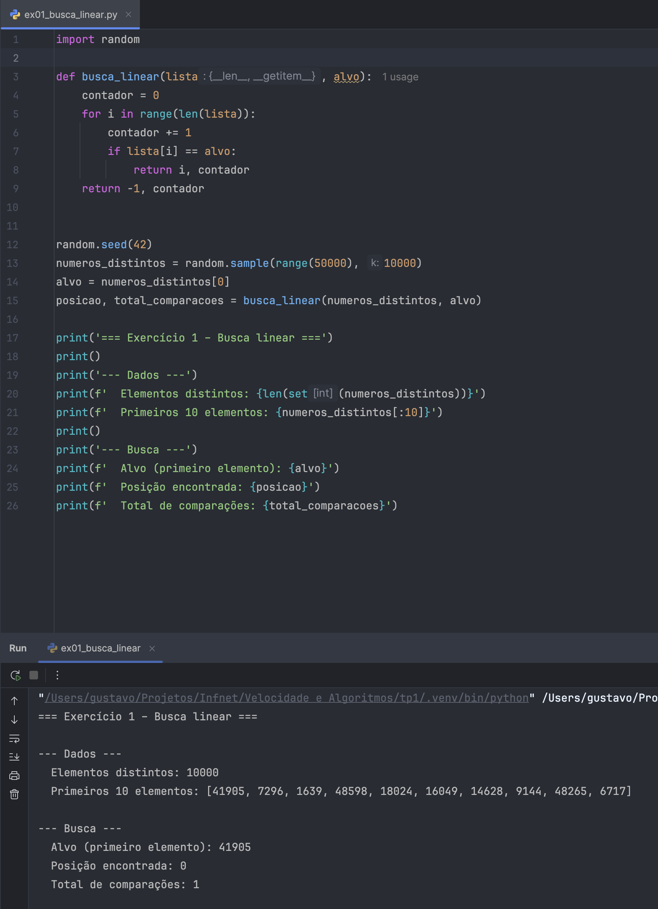

---

## Exercício 2 – Ordenação com cartas

O problema parte de 13 cartas de espadas, todas diferentes, dispostas em sequência em posições numeradas de 0 a 12. A ordem inicial é desconhecida e a única forma de chegar a uma carta é pela sua posição, como acontece em um array. Adotei a ordem tradicional dos valores: o Ás é a menor carta, seguido de 2, 3, 4, 5, 6, 7, 8, 9, 10, Valete, Dama e Rei, que é a maior. Como todas as cartas são do mesmo naipe, o naipe não entra na comparação. O estado final esperado é a sequência do Ás ao Rei ocupando as posições de 0 a 12, nessa ordem.

As operações permitidas seguem as limitações de um array. Posso ler a carta de uma posição, comparar duas cartas entre si e escrever uma carta em uma posição. Interpretei a restrição de mover uma carta por vez como a possibilidade de levar uma carta para qualquer posição indicada pelo índice, desde que apenas uma carta seja movida a cada operação. Como não é possível ter duas cartas ocupando a mesma posição, uso uma "mão" de apoio, que segura uma carta temporariamente enquanto a outra muda de lugar. Não uso funções prontas de ordenação, só comparação e troca.

O procedimento funciona em rodadas. Na primeira, assumo que a carta da posição 0 é a menor e guardo seu valor e sua posição. Depois percorro todas as cartas à direita, uma a uma, comparando cada uma com a menor encontrada até então. Sempre que aparece uma carta menor, apenas anoto o valor e a posição dela, sem mover nada. Ao chegar ao final, sei exatamente onde está a menor carta de todo o conjunto restante. Se ela já estiver na posição 0, nada é feito. Caso contrário, troco as duas cartas de lugar, usando a mão de apoio. Com isso, a posição 0 passa a ter a carta correta e não será mais tocada. A segunda rodada repete o mesmo raciocínio a partir da posição 1, considerando só as cartas da posição 1 em diante, e assim sucessivamente. Quando chego à penúltima posição, resta apenas uma carta, que por exclusão já é a maior e está no lugar certo, por isso são necessárias 12 rodadas para 13 cartas.

Para ilustrar, simulei o procedimento com 5 cartas na ordem Rei, 5, Ás, 9, 3. Na primeira rodada, a menor é o Ás, que está na posição 2, e ele é trocado com o Rei, resultando em Ás, 5, Rei, 9, 3. Na segunda, a menor entre as restantes é o 3, que vai para a posição 1, e o 5 segue para o lugar dele: Ás, 3, Rei, 9, 5. Na terceira, a menor é o 5, trocado com o Rei: Ás, 3, 5, 9, Rei. Na quarta rodada, o 9 já está na posição certa e não há troca. O resultado é Ás, 3, 5, 9, Rei, com 10 comparações e 3 trocas. Também implementei e executei o procedimento em Python com as 13 cartas embaralhadas (usando seed 42), e o resultado final saiu corretamente ordenado, com 78 comparações e 9 trocas.

O procedimento que construí se aproxima do Selection Sort. Não parti da lista de algoritmos clássicos para escolher um: decompus o problema com base nas restrições apresentadas e a solução a que cheguei coincide com um algoritmo que já existe. A semelhança está nas operações realizadas. Em cada rodada o Selection Sort percorre a parte ainda não ordenada para descobrir a menor carta e só depois faz uma única troca, levando essa carta para a posição correta, e é exatamente isso que o meu procedimento faz. Isso o diferencia do Bubble Sort, que troca pares vizinhos ao longo da varredura, e do Insertion Sort, que pega uma carta por vez e a encaixa entre as já ordenadas.

Quanto ao custo, em termos de Big O o algoritmo é O(n²). Na primeira rodada são feitas n−1 comparações, na segunda n−2, e assim por diante até 1, o que dá n(n−1)/2 comparações no total. Esse número cresce proporcionalmente ao quadrado de n, e o Big O guarda apenas esse termo dominante, descartando constantes. Com 13 cartas são 78 comparações, como mostrou a execução. Esse total é sempre o mesmo, mesmo que as cartas já estejam ordenadas, pois o algoritmo não tem como saber disso sem varrer o restante. O número de trocas, por outro lado, é no máximo n−1, já que há no máximo uma por rodada. Esse é um ponto em que ele se diferencia do Bubble Sort: ambos são O(n²), mas o Selection Sort realiza muito menos trocas. O uso de memória extra é constante, O(1), pois só são necessárias a mão de apoio e algumas variáveis auxiliares.

Código: [`codigos/ex02_cartas.py`](codigos/ex02_cartas.py)

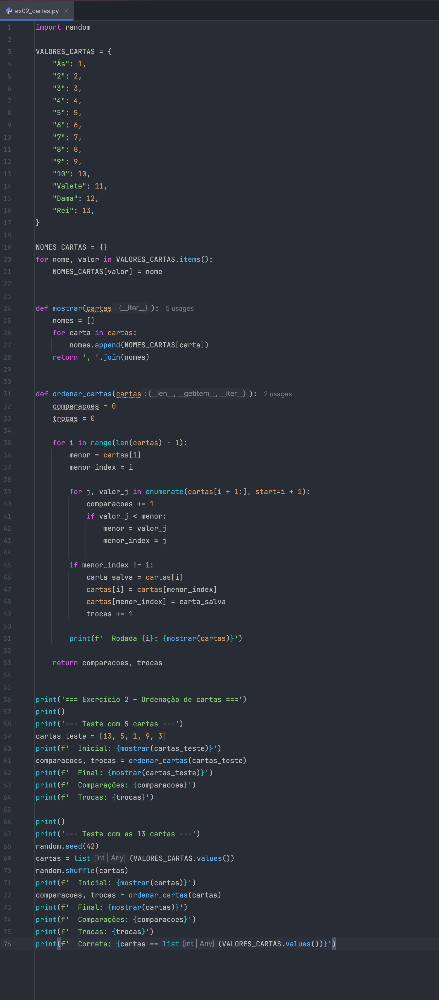

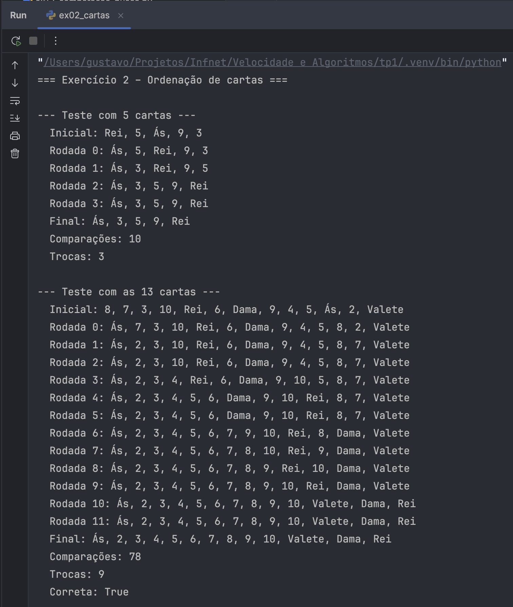

---

## Exercício 3 – Busca linear (análise manual)

O array é [2, 4, 6, 8, 10, 12, 13] e o valor procurado é o 8. A busca linear começa na primeira posição e compara cada elemento com o alvo, avançando um a um até encontrá-lo ou chegar ao fim. Na posição 0, 2 é diferente de 8 (1ª comparação). Na posição 1, 4 é diferente de 8 (2ª). Na posição 2, 6 é diferente de 8 (3ª). Na posição 3, 8 é igual ao alvo (4ª), e a busca para. O total é de 4 comparações.

O resultado se explica pela posição do elemento: o 8 está no índice 3, e como a busca começa no índice 0 e conta uma comparação por posição visitada, o número de comparações é sempre o índice mais um. A busca linear não aproveita o fato de o array estar ordenado, então ela visita todos os elementos anteriores ao alvo. Em relação ao tamanho do array (n = 7), foram necessárias 4 comparações, mais da metade dos elementos. No melhor caso, com o alvo na primeira posição, seria 1 comparação, e no pior caso, com o alvo na última posição (13) ou ausente, seriam 7, ou seja, n. Por isso o custo da busca linear cresce proporcionalmente ao tamanho da entrada, o que é O(n).

---

## Exercício 4 – Busca binária (análise manual)

Usando o mesmo array e o mesmo alvo, a busca binária mantém dois limites, esquerdo e direito, que delimitam a região onde o alvo ainda pode estar. Inicialmente o limite esquerdo é 0 e o direito é 6. O índice do meio é (0 + 6) // 2 = 3, e o elemento nessa posição é 8, que é exatamente o alvo. A busca termina na primeira iteração, com 1 comparação.

Comparando com a busca linear, que precisou de 4 comparações para o mesmo valor, a diferença é de 4 contra 1. É importante notar, porém, que esse caso é favorável à busca binária, pois o 8 por acaso está bem no meio do array. Em um caso menos favorável, como procurar o 13 (a última posição), a busca binária faria: meio = 3 (8 < 13, descarta a metade esquerda), meio = 5 (12 < 13, descarta de novo) e meio = 6 (13, encontrado), totalizando 3 comparações, contra 7 da busca linear.

Essa diferença se explica pela forma como cada algoritmo reduz o espaço de busca. A busca linear elimina um elemento por comparação, então no pior caso faz n comparações, o que é O(n). A busca binária, aproveitando que o array está ordenado, elimina metade dos elementos restantes a cada comparação, então no pior caso faz cerca de log₂(n) comparações, o que é O(log n). Para n = 7, o pior caso da binária são 3 comparações, contra 7 da linear. Essa diferença é pequena com poucos elementos, mas se torna enorme quando n cresce: para um milhão de elementos, a linear pode chegar a 1.000.000 de comparações, enquanto a binária precisa de no máximo cerca de 20. O custo dessa vantagem é o pré-requisito de que o array esteja ordenado.

Para conferir a análise manual, implementei a busca binária em Python e executei para vários alvos. Os resultados coincidem com a simulação: o 8 é encontrado com 1 comparação e o 13 com 3.

Código: [`codigos/ex04_busca_binaria.py`](codigos/ex04_busca_binaria.py)

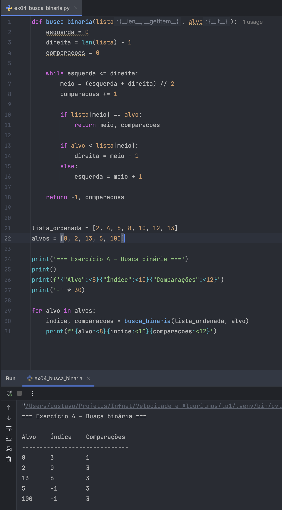

---

## Exercício 5 – Otimização de algoritmo

A função `maior_unico` recebe um array e devolve o maior número que aparece exatamente uma vez nele, ou `None` se nenhum valor satisfaz essa condição. Ela tem dois laços aninhados. O laço de fora percorre os N elementos, e para cada um deles o laço de dentro percorre o array inteiro, também N vezes, só para contar quantas vezes aquele valor aparece. Nenhum dos laços é interrompido antes do fim, então o número de comparações `arr[j] == atual` é sempre N × N, independentemente do conteúdo do array. As demais operações do corpo, como o teste `contador == 1` e a atualização de `maior`, têm custo constante e não alteram a classe de complexidade. Por isso a função é O(N²). O motivo de fundo é desperdício: a quantidade de vezes que um valor aparece é uma propriedade do array inteiro e não depende da posição que está sendo examinada, mas o código a recalcula do zero, com uma varredura completa, para cada elemento. Se o mesmo número aparece três vezes, a contagem dele é refeita três vezes.

Para chegar a O(N), reescrevi a função com uma estratégia de calcular a contagem uma única vez e depois apenas consultá-la. Na primeira passada, percorro o array e guardo em um dicionário quantas vezes cada valor apareceu. Para cada elemento, consulto a contagem atual dele (usando zero quando ele ainda não está no dicionário), somo um e gravo de volta. Cada elemento do array é visto uma vez e atualiza apenas o seu próprio contador, então ao final da passada o dicionário tem a resposta para todos os valores de uma só vez. Na segunda passada, percorro o dicionário, e não mais o array original, e entre os valores cuja contagem é exatamente um, guardo o maior, com a mesma lógica de atualização da versão original. Se nenhum valor aparece uma única vez, `maior` continua `None`, como antes. O laço de dentro deixou de ser necessário porque sua única função era responder "quantas vezes este valor aparece?", e essa resposta agora está pronta no dicionário, onde a consulta tem custo constante em vez de uma varredura.

A nova complexidade é O(N). A primeira passada faz N iterações, cada uma com uma consulta e uma gravação no dicionário em tempo constante, o que custa N. A segunda passada percorre no máximo N entradas, já que o dicionário nunca tem mais chaves do que o array tem elementos, o que custa no máximo N. Como os dois laços estão em sequência, e não um dentro do outro, os custos se somam em vez de se multiplicarem: o total é da ordem de 2N, e o Big O descarta a constante, resultando em O(N). Na prática, o crescimento passa de quadrático para linear: com 1.000 elementos, a versão original faz cerca de 1.000.000 de comparações, enquanto a nova faz da ordem de 2.000 operações.

Esse ganho de tempo tem um custo de memória. A versão original usava apenas algumas variáveis, ou seja, memória extra constante, O(1). A nova precisa do dicionário de contagens, que no pior caso, quando todos os valores são distintos, tem uma entrada para cada elemento do array, ou seja, memória extra O(N). É uma troca clássica de espaço por tempo, vantajosa neste caso porque o dicionário permite eliminar uma varredura inteira por elemento. Para verificar que a funcionalidade foi preservada, executei as duas versões com os mesmos sete casos de teste, que incluem o maior valor repetido, todos os valores únicos, todos repetidos, lista vazia, um único elemento e números negativos, e os resultados foram idênticos em todos eles, como mostram os prints.

Código: [`codigos/ex05_maior_unico.py`](codigos/ex05_maior_unico.py)

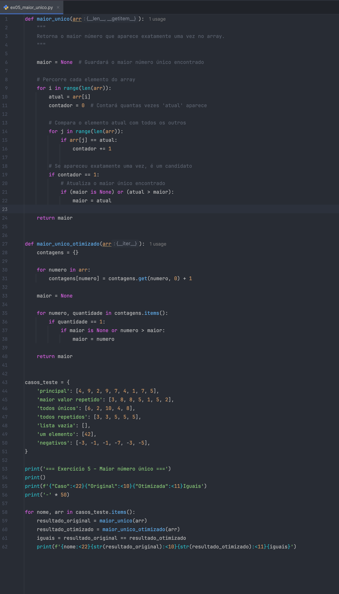

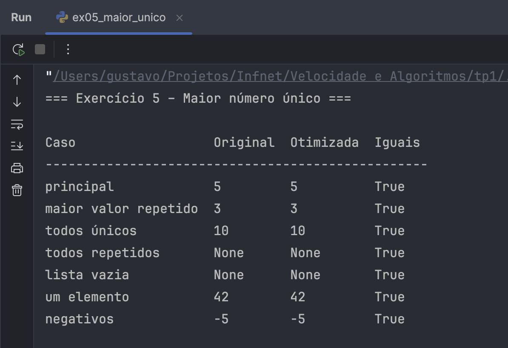

---

## Exercício 6 – Tabuleiro de xadrez e grãos de arroz

A função `tabuleiro_xadrez` recebe uma quantidade alvo de grãos e devolve o menor quadrado do tabuleiro cuja quantidade de grãos, naquele próprio quadrado, é maior ou igual ao alvo. Ela simula o tabuleiro passo a passo, sem usar fórmula pronta para calcular o índice diretamente. Duas variáveis acompanham a simulação: o quadrado atual, que começa em 1, e a quantidade de grãos nele, que também começa em 1. Enquanto os grãos do quadrado atual forem menores que o alvo e ainda existir um próximo quadrado, ou seja, o atual for menor que 64, a função avança: soma 1 ao número do quadrado e dobra a quantidade de grãos, seguindo a regra do enunciado de que cada quadrado tem o dobro do anterior. O limite de 64 é guardado numa constante, para o valor não ficar solto no código.

O laço pode parar por dois motivos: os grãos bastaram ou o tabuleiro acabou. Como os dois podem ocorrer ao mesmo tempo, por exemplo quando o alvo é exatamente a quantidade do quadrado 64, a função não tenta descobrir por que o laço parou. Ela verifica a condição de sucesso depois dele: se os grãos do quadrado atual são maiores ou iguais ao alvo, devolve o quadrado; caso contrário, devolve a mensagem de que a quantidade excede o limite do tabuleiro. Essa verificação foi o ponto mais delicado. Uma versão anterior permitia ao laço avançar até um quadrado 65 que não existe, o que fazia o valor 2⁶³ + 1 retornar o quadrado 65 em vez da mensagem, e a correção foi trocar o limite do laço para que ele pare no quadrado 64.

Testei a função com valores pequenos (1, 2, 4 e 8, que retornaram os quadrados 1, 2, 3 e 4), intermediários (1.000, que retornou o quadrado 11, e 1.000.000, que retornou o quadrado 21) e valores acima do limite. O quadrado 64 tem 2⁶³ grãos, então o valor 2⁶³ retornou o quadrado 64, o último possível, enquanto 2⁶³ + 1 e 2⁶⁴ retornaram a mensagem de excesso. Esse par de valores é o que confirma que a fronteira do tabuleiro está correta.

Quanto à complexidade, o custo da função é proporcional ao número de vezes que o laço executa, já que cada volta faz apenas uma comparação, uma soma e uma multiplicação, todas de custo constante. A quantidade de grãos dobra a cada volta, então o número de voltas necessárias para alcançar um alvo é aproximadamente o logaritmo de base 2 desse alvo. Os testes mostram isso: para 1.000 o laço deu 10 voltas (do quadrado 1 ao 11), para 1.000.000 deu 20 voltas (do quadrado 1 ao 21), e para o último quadrado deu 63. Ou seja, multiplicar o alvo por mil acrescenta apenas cerca de dez voltas, o que é um crescimento logarítmico, O(log N) em função do valor pedido. Isso é o oposto de uma busca linear, e funciona justamente porque a quantidade de grãos cresce de forma exponencial. Como o tabuleiro tem exatamente 64 quadrados, o laço nunca passa de 63 voltas, qualquer que seja o alvo. Em termos estritos, isso faz do custo desta implementação um limite constante, O(1), e a análise logarítmica descreve como esse número de voltas cresce até bater no teto. A memória usada é constante, O(1), pois a função só guarda duas variáveis e a constante do limite.

Código: [`codigos/ex06_tabuleiro_xadrez.py`](codigos/ex06_tabuleiro_xadrez.py)

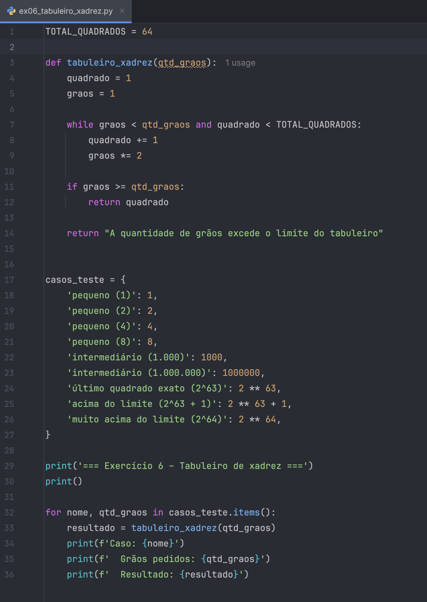

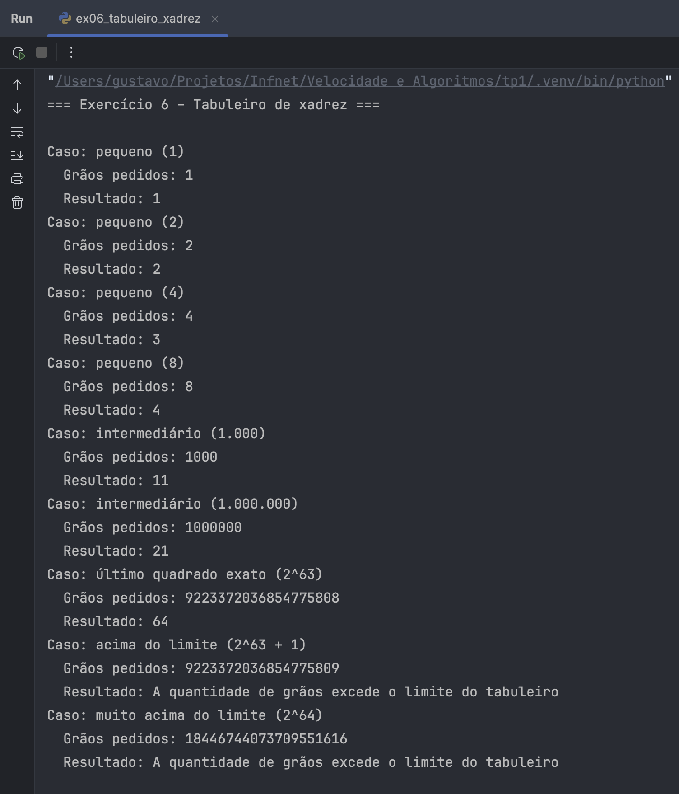

---

## Exercício 7 – Notação Big O (análise de código)

A função `only_a_strings` recebe um array de N strings e percorre todas elas com um único laço `for`. Esse laço executa exatamente N vezes, uma para cada elemento, independentemente do conteúdo das strings: nenhum `break` ou `return` interrompe a iteração antes do fim, então o número de repetições depende só do tamanho da entrada.

A cada iteração, a função faz poucas operações. Primeiro avalia a condição `len(s) > 0 and s[0] == "a"`, que consiste em obter o tamanho da string, compará-lo com zero e, se ele for maior, acessar o primeiro caractere e compará-lo com "a". Depois, apenas se a condição for verdadeira, executa `append` para incluir a string na lista de resultado. Pelas premissas do exercício, `len`, o acesso ao primeiro caractere, a comparação e o `append` custam O(1), e as strings têm tamanho médio constante, então o trabalho de cada iteração é limitado por uma constante. Fora do laço, a criação da lista vazia e o `return` também são operações de custo constante.

O custo total da função é, portanto, o trabalho de uma iteração repetido N vezes, mais as poucas operações fixas de antes e depois do laço, como criar a lista vazia e devolver o resultado. Como cada iteração tem custo constante, o tempo total cresce na mesma proporção que o tamanho do array. Na notação Big O, ignoram-se o custo exato de cada iteração e as operações fixas, porque não mudam a forma do crescimento, e o que resta é O(N). O crescimento é linear porque, ao dobrar o tamanho do array, o número de iterações também dobra, e o custo de cada iteração permanece o mesmo. Esse resultado vale tanto para o pior caso (todas as strings começam com "a" e todas são adicionadas) quanto para o melhor caso (nenhuma começa com "a"), já que mesmo sem nenhum `append` o laço percorre todos os N elementos. A única diferença entre os casos é a quantidade de `append`, que também é limitada por N e só afeta o custo de cada iteração, não a forma do crescimento.

---

## Exercício 8 – Bubble Sort bidirecional

Modifiquei o Bubble Sort para que cada rodada tenha duas varreduras em sentidos opostos, controladas por dois índices externos, `esquerdo` e `direito`, que marcam a região da lista ainda não ordenada. Na primeira varredura, da esquerda para a direita, comparo pares vizinhos e troco quando o da esquerda é maior, o que leva o maior elemento da região até a posição `direito`. Em seguida o `direito` recua uma posição, porque aquele elemento já está no lugar. Na segunda varredura, da direita para a esquerda, comparo os pares no sentido contrário e troco quando o da esquerda é maior, o que leva o menor elemento da região até a posição `esquerdo`, e então o `esquerdo` avança uma posição. A repetição termina quando os dois índices se encontram, ou seja, quando a região desordenada acabou. Testei o algoritmo com listas desordenadas, já ordenadas, em ordem inversa, com o menor elemento no final, com valores repetidos, com números negativos, com um único elemento e vazia, e em todos os casos a saída foi a lista correta em ordem crescente.

Comparando com o Bubble Sort tradicional, a diferença está na forma como a lista vai sendo ordenada. O tradicional só varre num sentido, então empurra um elemento grande até o fim a cada passada, mas um elemento pequeno que está no final da lista só avança uma posição para a esquerda por passada. Por exemplo, em `[2, 3, 4, 5, 1]`, o 1 precisa de quatro passadas para chegar ao início. No Cocktail Sort, a varredura de volta leva esse 1 até a primeira posição de uma só vez, e a lista fica ordenada já na primeira rodada. Ou seja, a versão bidirecional trata melhor os elementos pequenos perto do fim, que são o ponto fraco do Bubble Sort comum, porque ele trabalha com os dois extremos da região ao mesmo tempo.

Em termos de custo, porém, as duas versões são equivalentes na análise assintótica: ambas são O(n²). Sem nenhuma condição de parada antecipada, as duas percorrem as mesmas regiões, então o número de comparações é o mesmo, e a quantidade de trocas depende apenas de quantos pares estão fora de ordem, o que também não muda de uma versão para a outra. A vantagem prática do Cocktail Sort só aparece quando ele é combinado com uma otimização de parada antecipada, interrompendo quando uma varredura não faz nenhuma troca, como será feito no Exercício 12, aí sim terminando antes em listas como a do exemplo. Resumindo, o Cocktail Sort é uma melhoria de estratégia, que diminui as rodadas necessárias em certos casos, mas não muda a classe de complexidade do Bubble Sort.

Código: [`codigos/ex08_cocktail.py`](codigos/ex08_cocktail.py)

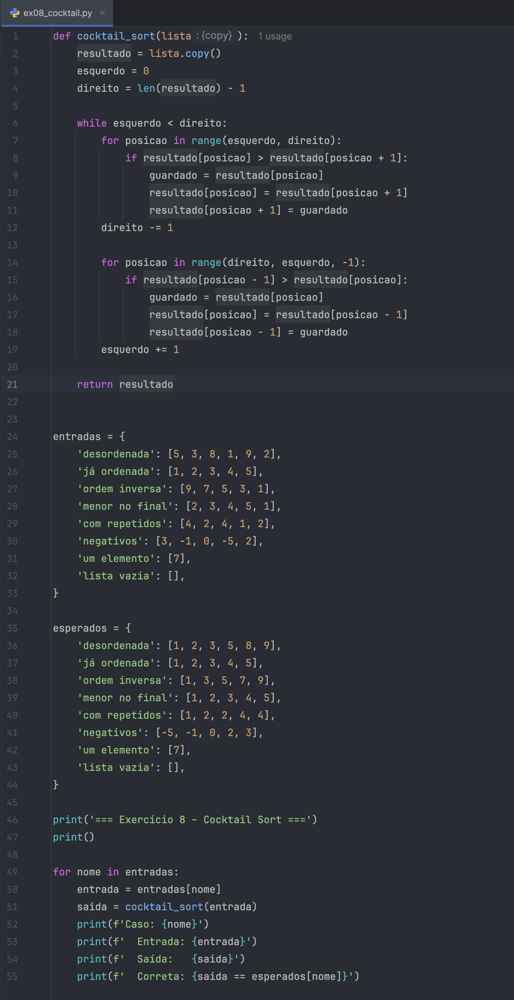

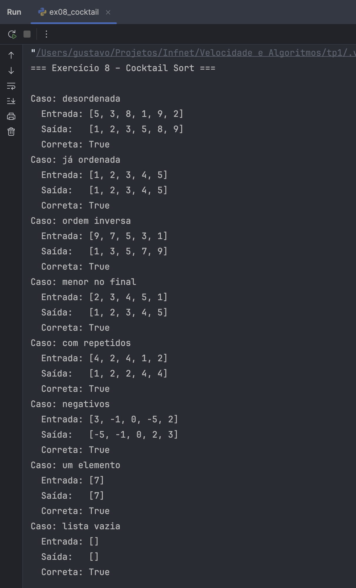

---

## Exercício 9 – Bubble Sort numérico

Implementei o Bubble Sort em Python para ordenar listas de números em ordem crescente. O algoritmo percorre a lista comparando pares de elementos vizinhos e troca os dois de lugar quando o da esquerda é maior que o da direita. Ao fim de cada passada, o maior elemento da região ainda não ordenada fica na sua posição definitiva, no final dessa região, então a passada seguinte pode ignorar esse elemento. O laço externo controla essas passadas, começando com a região inteira e encolhendo uma posição por vez, e o laço interno faz as comparações dentro da região atual. A função trabalha em uma cópia da lista, de modo que a lista original não é alterada, e a troca usa uma variável auxiliar para guardar um dos valores enquanto o outro muda de lugar.

Para verificar a corretude, testei a função com diferentes tipos de lista e comparei cada saída com o resultado esperado, escrito manualmente. Os testes incluem uma lista desordenada, uma lista que já estava ordenada, uma em ordem inversa, uma com valores repetidos, uma com números negativos, uma com números decimais, uma com um único elemento e uma lista vazia. Em todos os casos a saída foi a lista correta em ordem crescente, e a verificação retornou `True`, como mostram os prints. A lista já ordenada passou sem nenhuma alteração, e a lista em ordem inversa foi o caso mais trabalhoso, pois todos os pares estavam fora de ordem. Os valores repetidos permaneceram na lista na quantidade original, sem se perder nenhum, o que confirma que o algoritmo só troca de posição e nunca descarta elementos.

Código: [`codigos/ex09_bubble_sort.py`](codigos/ex09_bubble_sort.py)

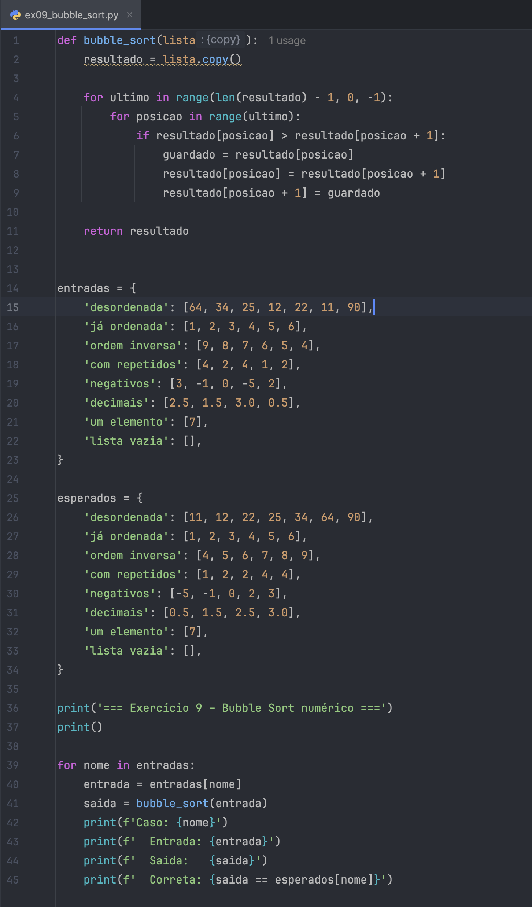

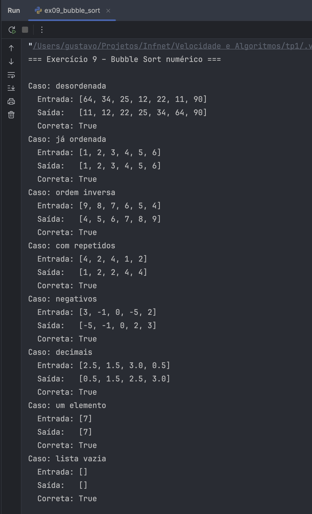

---

## Exercício 10 – Bubble Sort para strings

Adaptei o Bubble Sort para ordenar listas de palavras em ordem alfabética. A estrutura do algoritmo é a mesma da versão numérica, com um laço externo que controla as passadas e um laço interno que compara pares vizinhos e troca quando o da esquerda é maior que o da direita. A única mudança está no tipo de dado: em Python, o operador `>` também funciona com strings, e o resultado segue a ordem lexicográfica, em que as palavras são comparadas caractere a caractere, da esquerda para a direita, até aparecer o primeiro caractere diferente. Se uma palavra for prefixo da outra, a mais curta vem primeiro. Isso mostra que o Bubble Sort não depende do tipo dos dados, apenas de ser possível comparar dois elementos e trocá-los de posição.

Testei a função com listas de frutas, de nomes já ordenados, de palavras em ordem inversa, com palavras repetidas, com palavras que compartilham o mesmo prefixo, com letras maiúsculas e minúsculas misturadas, com acentos, com uma única palavra e com uma lista vazia. Em todos os casos a saída coincidiu com o resultado esperado, escrito à mão. Nas palavras com o mesmo prefixo, a ordem foi `cas`, `casa`, `casaco`, `casal`, porque `cas` é prefixo das demais e vem primeiro, e porque `casaco` e `casal` coincidem até `casa` e só se diferenciam no quinto caractere, onde `c` vem antes de `l`. As palavras repetidas ficaram juntas, sem perda de nenhuma.

Dois comportamentos observados merecem atenção, porque a comparação é feita pelo código numérico de cada caractere, e não pela ordem do alfabeto como uma pessoa a lê. O primeiro é que letras maiúsculas vêm antes de todas as minúsculas: na lista `banana`, `Abacaxi`, `uva`, `Manga`, o resultado foi `Abacaxi`, `Manga`, `banana`, `uva`, com as palavras iniciadas por maiúscula na frente, mesmo que `banana` viesse antes de `Manga` no alfabeto. O segundo é que letras acentuadas têm códigos maiores que as letras sem acento, então `árvore` ficou depois de `zebra`. Se uma ordenação alfabética estritamente humana fosse necessária, seria preciso comparar versões normalizadas das palavras, por exemplo todas em minúsculas e sem acento, mas isso está fora do escopo deste exercício, e o comportamento padrão foi mantido e documentado. O custo do algoritmo continua O(n²) em número de comparações, com a ressalva de que cada comparação entre strings custa proporcionalmente ao tamanho do prefixo em comum, e não é uma operação de custo constante como entre números.

Código: [`codigos/ex10_bubble_strings.py`](codigos/ex10_bubble_strings.py)

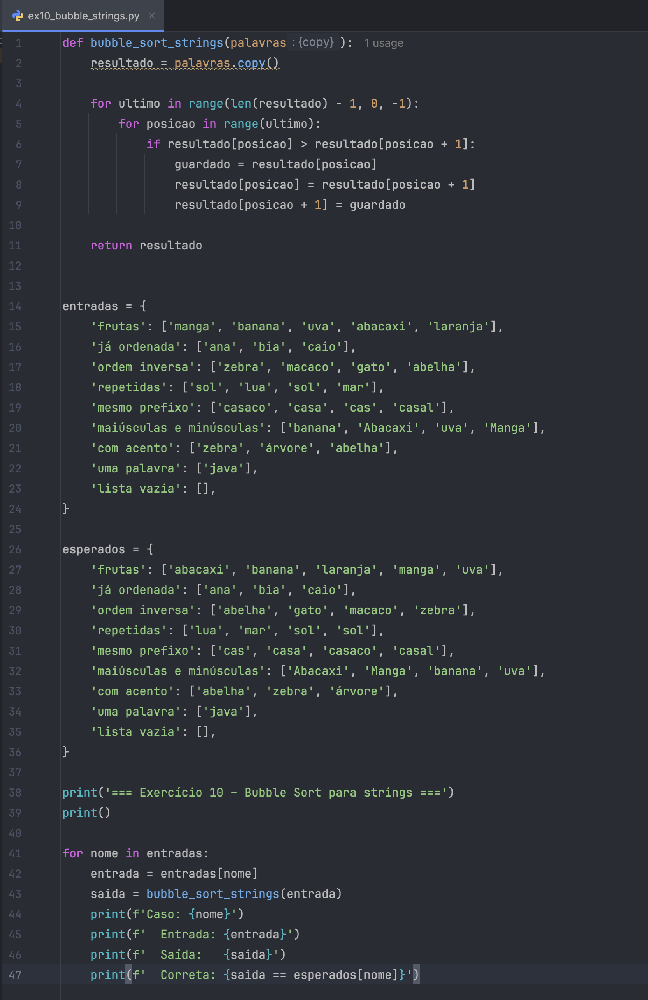

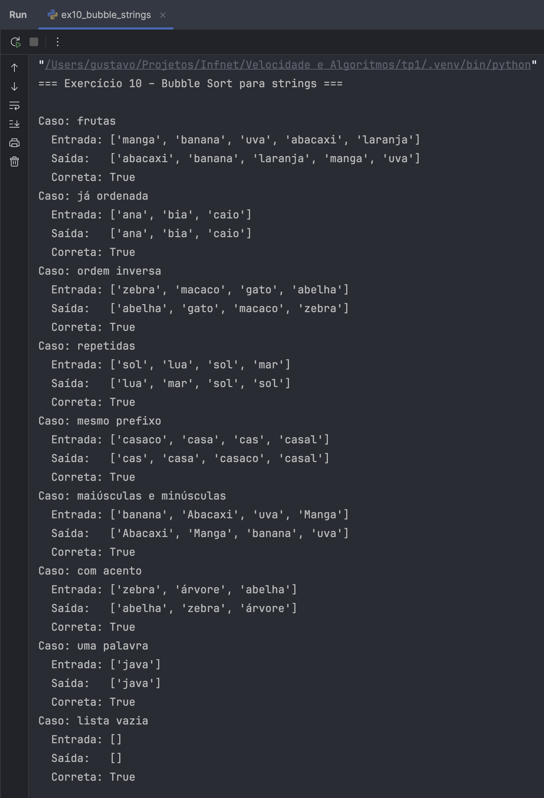

---

## Exercício 11 – Instrumentação do Bubble Sort

Instrumentei o Bubble Sort com dois contadores: um de comparações, que sobe a cada par de vizinhos examinado, e um de trocas, que sobe apenas quando os dois elementos de fato trocam de lugar. A função devolve a lista ordenada junto com os dois totais. Executei o algoritmo com cinco tamanhos de entrada (10, 20, 40, 80 e 160 elementos), sempre dobrando o tamanho anterior, e para cada tamanho usei três cenários: uma lista aleatória gerada com semente fixa, para que o experimento seja reproduzível, uma lista já ordenada e uma lista em ordem inversa.

Os resultados mostram que o número de comparações não depende do conteúdo da lista, só do tamanho. Para 10 elementos foram 45 comparações nos três cenários, e para 160 elementos foram 12.720, e esses valores coincidem exatamente com a fórmula N(N−1)/2 mostrada na última coluna da tabela. Isso acontece porque o algoritmo sempre faz N−1 comparações na primeira passada, N−2 na segunda, e assim por diante, sem nenhuma condição de parada. Já o número de trocas depende da organização dos dados: na lista já ordenada foi sempre zero, na lista inversa foi igual ao número de comparações, pois todos os pares estavam fora de ordem, e na lista aleatória ficou em cerca de metade das comparações. Isso significa que o pior caso de trocas é o da lista inversa, o melhor é o da lista ordenada, e o caso aleatório fica entre os dois.

Quanto ao crescimento, cada vez que o tamanho da entrada dobra, o número de comparações é multiplicado por aproximadamente quatro. Esse comportamento é típico de uma função quadrática: dobrar N multiplica N² por quatro. Os dados confirmam, portanto, que o Bubble Sort tem complexidade O(N²) em comparações em qualquer cenário, e que a quantidade de trocas, no pior caso, também cresce de forma quadrática. Um ponto importante é que, nesta versão, uma lista já ordenada custa o mesmo número de comparações que uma lista totalmente embaralhada, porque o algoritmo não tem como perceber que já terminou. Essa ineficiência é a que será tratada no próximo exercício.

Código: [`codigos/ex11_bubble_sort_instrumentado.py`](codigos/ex11_bubble_sort_instrumentado.py)

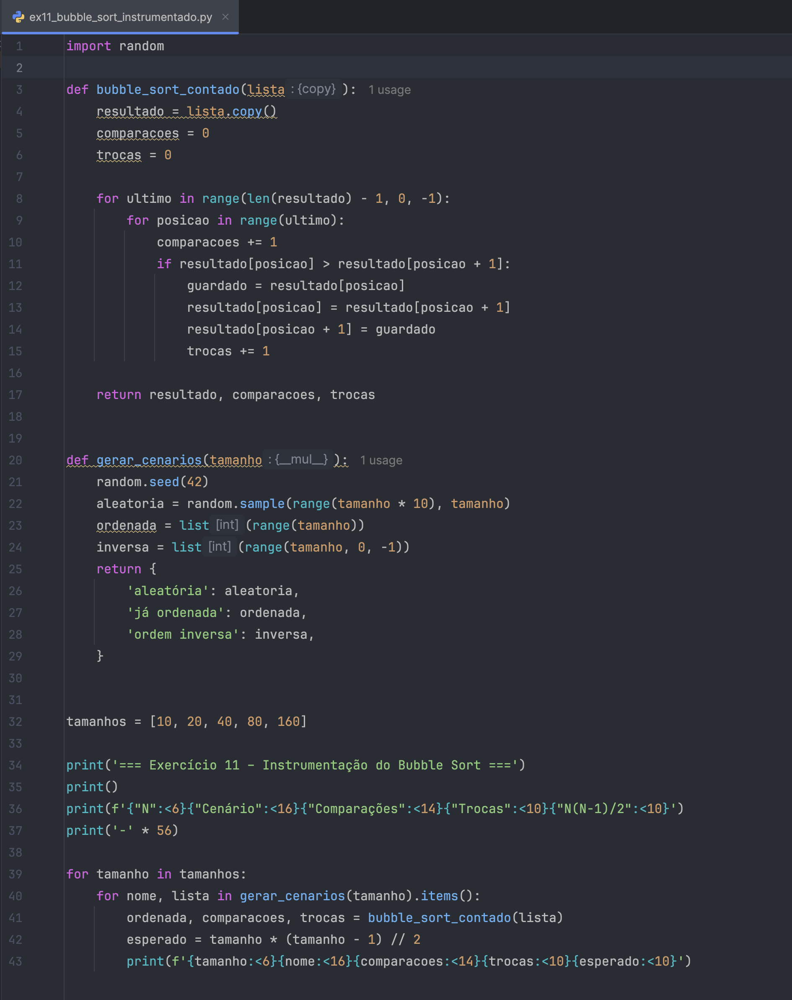

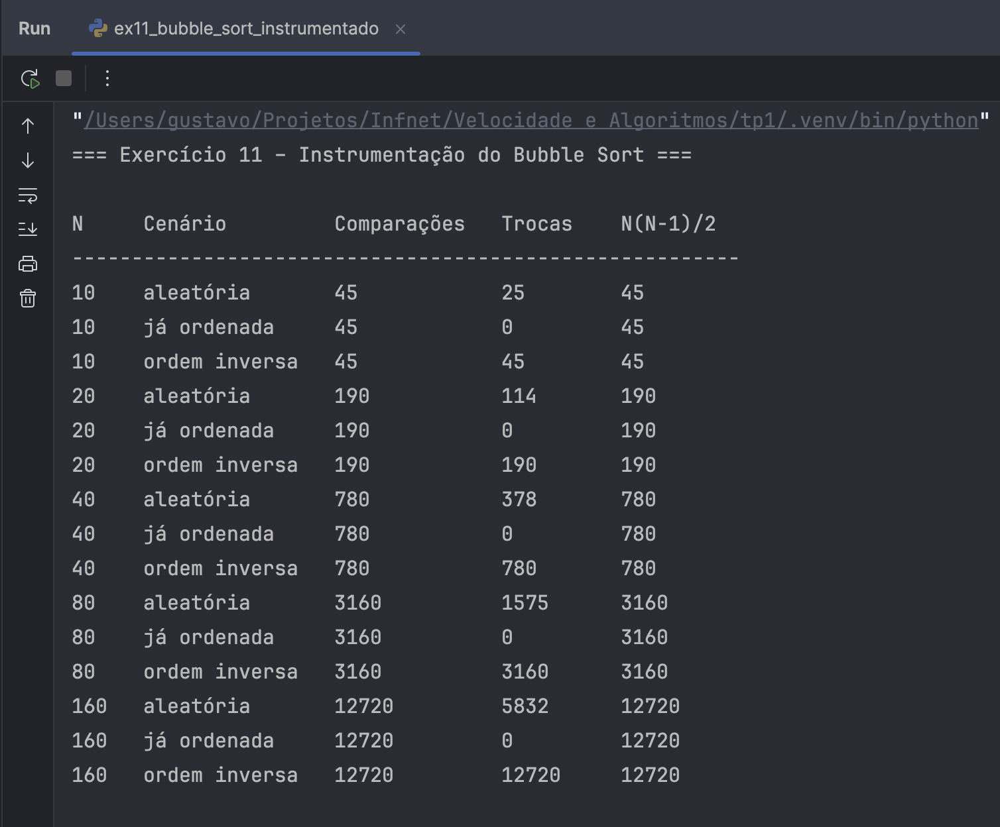

---

## Exercício 12 – Bubble Sort otimizado

Apliquei ao Bubble Sort a otimização de parar quando uma passada inteira não faz nenhuma troca. A ideia é simples: se o algoritmo percorreu todos os pares e nenhum estava fora de ordem, a lista já está ordenada, e continuar seria perder tempo. Para isso, criei uma variável que começa como falsa no início de cada passada e vira verdadeira se houver alguma troca. No fim da passada, se ela continuou falsa, o laço é encerrado. Executei a versão otimizada com os mesmos dados do Exercício 11 e conferi que as duas versões chegam à mesma lista ordenada.

Comparando os resultados, o ganho depende de como os dados estavam organizados no início. Com a lista já ordenada, a diferença é grande: a versão otimizada faz uma única passada, enquanto a original continuava fazendo todas as passadas mesmo sem nada para trocar. Para 160 elementos, por exemplo, foram 159 comparações contra 12.720. Com a lista em ordem inversa, não houve ganho nenhum, porque sempre há trocas até a última passada e o algoritmo precisa ir até o fim. Com a lista aleatória, o ganho foi pequeno, pois a lista só fica ordenada nas últimas passadas, então a parada antecipada quase não aparece. O número de trocas foi o mesmo nas duas versões, já que a otimização só evita comparações desnecessárias e não muda a ordenação em si.

Em relação ao Big O, o pior caso continua igual: com a lista em ordem inversa, o algoritmo ainda faz o mesmo número de comparações, então a complexidade segue sendo O(N²). O que melhora é o melhor caso, que passa a ser O(N), porque uma lista já ordenada é resolvida com uma única passada. Isso mostra que uma otimização pode ajudar em certas situações sem mudar a classe de complexidade do pior caso, que é a que o Big O descreve.

Código: [`codigos/ex12_bubble_sort_otimizado.py`](codigos/ex12_bubble_sort_otimizado.py)

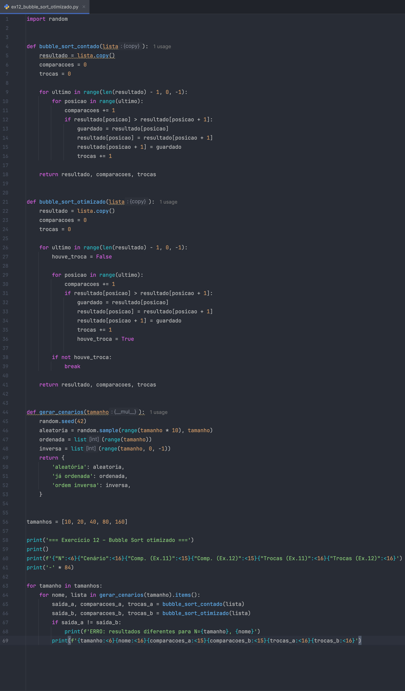

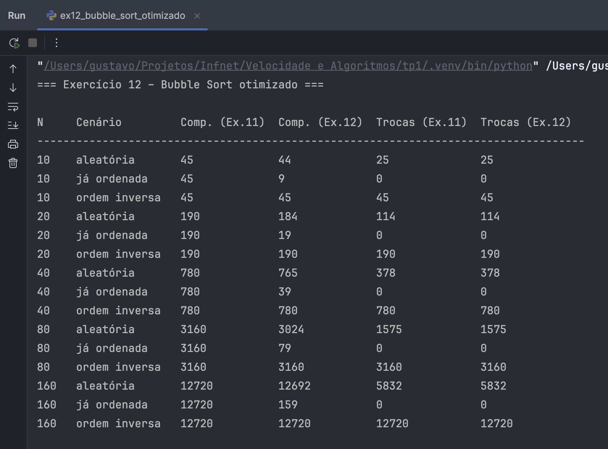

---

## Exercício 13 – Comparação de estratégias de busca

Implementei as três funções pedidas, com os nomes do enunciado: `linear_search_count`, `binary_search_count` e `bubble_sort_count`, todas devolvendo o resultado junto com o número de comparações. Depois montei três listas com 31 elementos (ordenada, em ordem inversa e embaralhada com semente fixa) e executei as buscas para o primeiro elemento, o elemento do meio e um valor ausente. Para as listas que não estão em ordem crescente, a busca binária só foi aplicada depois de ordenar a lista com o Bubble Sort, e a tabela mostra o custo da ordenação e o total das duas etapas.

Código: [`codigos/ex13_comparacao_busca.py`](codigos/ex13_comparacao_busca.py)

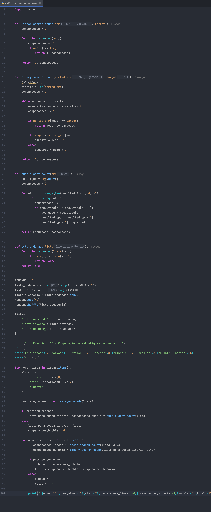

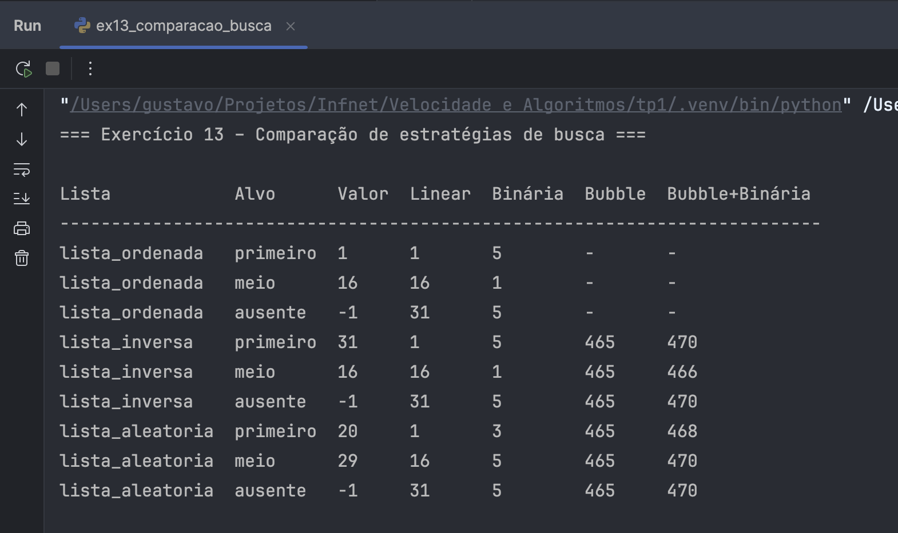

### Conclusão

A busca linear não exige nada da lista: ela percorre os elementos um a um, então funciona em qualquer ordem. A busca binária exige que a lista esteja ordenada, porque a cada comparação ela descarta metade dos elementos partindo da ideia de que, se o alvo é menor que o elemento do meio, ele só pode estar à esquerda, e se é maior, só pode estar à direita. Em uma lista fora de ordem essa ideia deixa de valer e a busca pode errar.

Em relação ao Big O, a busca linear é O(N), pois no pior caso, quando o alvo está na última posição ou não existe, ela compara com todos os elementos. Nos testes com 31 elementos, o alvo ausente exigiu as 31 comparações. A busca binária é O(log N), porque a cada comparação o espaço de busca cai pela metade, então o número de comparações cresce bem devagar. Nos testes, o pior caso foram 5 comparações. Já o Bubble Sort é O(N²), e nos testes foram 465 comparações em todas as listas, porque a versão usada não para antes de percorrer tudo.

Para uma única busca, ordenar a lista antes não compensa. Nos testes, o Bubble Sort custou 465 comparações, enquanto a busca linear, mesmo no pior caso, custou 31. Somando a ordenação com a busca binária, o total ficou sempre muito acima da busca linear. Quando o alvo estava no início da lista, a busca linear foi ainda melhor, com apenas uma comparação. A ordenação só passa a compensar quando a lista vai ser consultada muitas vezes, porque o custo de ordenar é pago uma vez e depois cada busca binária faz muito menos comparações do que a linear. Por isso, com poucas buscas a linear é a melhor escolha, e com muitas buscas sobre a mesma lista vale ordenar e usar a binária. Se a lista já estiver ordenada, a binária é sempre a melhor opção, como se vê em `lista_ordenada`, onde ela fez no máximo 5 comparações contra 31 da linear. Em listas muito maiores, o custo quadrático do Bubble Sort pesaria demais, e seria preciso um algoritmo de ordenação mais eficiente, mas isso está fora do escopo deste exercício.

---

## Exercício 14 – Organização de código e qualidade

Refatorei as funções `f` e `h`, que são, respectivamente, uma busca binária com contador e um Bubble Sort com contador, sem alterar a lógica, os contadores nem os critérios de parada. A busca virou `busca_binaria_contada` e a ordenação virou `bubble_sort_contado`, com nomes de variáveis e parâmetros que dizem o que cada um representa, uma estrutura mais fácil de ler e comentários técnicos objetivos. A complexidade continua a mesma, O(log N) para a busca e O(N²) para a ordenação. Para demonstrar que o comportamento foi preservado, o próprio arquivo executa as versões original e refatorada nos mesmos dados e compara os resultados completos, e todos os casos deram `True`.

Código: [`codigos/ex14_organizacao_codigo.py`](codigos/ex14_organizacao_codigo.py)

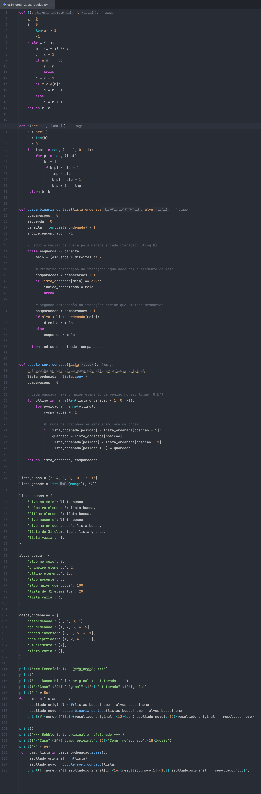

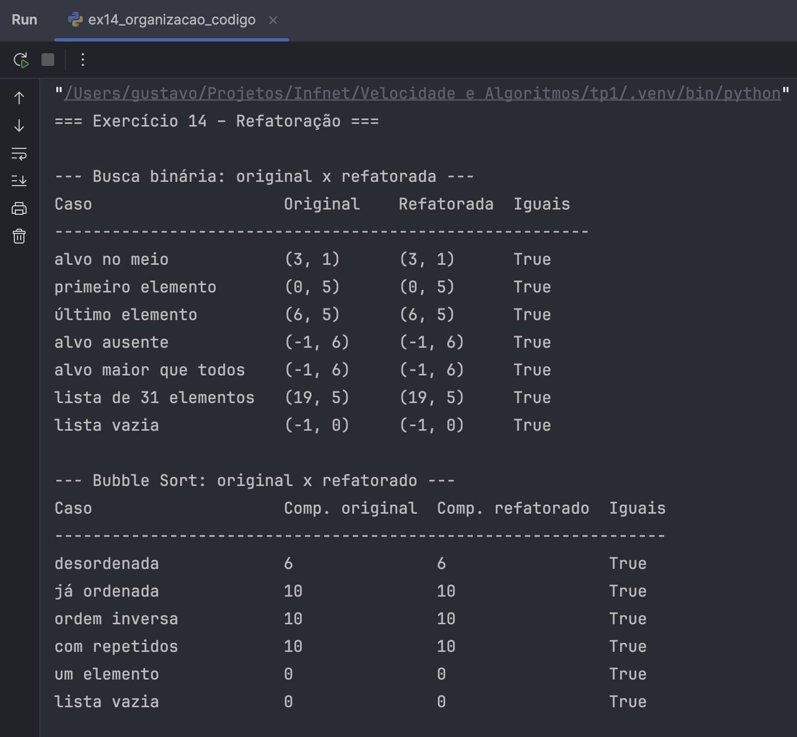
